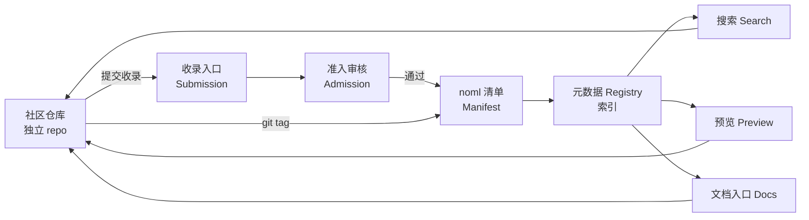
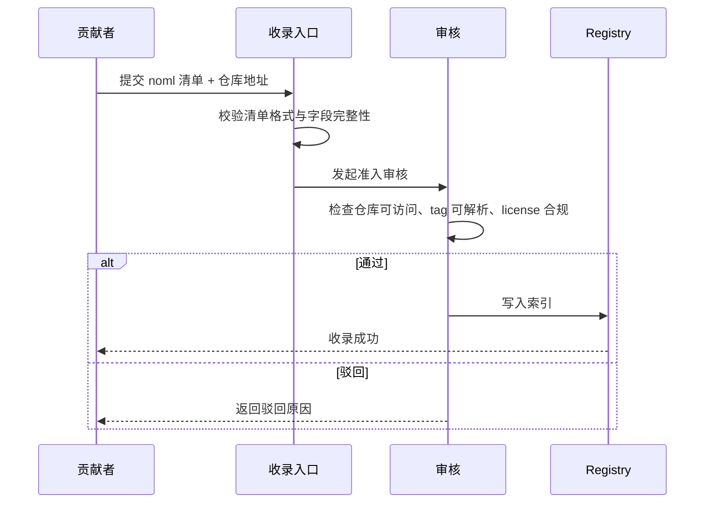

# nohub

> 一个「只索引、不存码」的社区包清单注册中心。

nohub 是一个面向社区第三方库的**元数据注册中心（metadata registry）**。它不托管任何源码，源码始终留在各自的独立仓库中；nohub 只负责收录、索引、准入审核，并对外提供搜索、预览与文档入口。

---

## 核心定位

nohub 解决的是「社区包发现难、来源散、质量不可控」的问题，但刻意不做源码托管。它扮演的角色类似 crates.io 的索引、npm 的 registry 元数据层，而不是 GitHub。

具体来说，nohub 只做四件事：

1. **包清单索引与元数据 registry** —— 以 `noml` 清单为基本单元，为每个收录的包建立可检索的元数据记录。
2. **社区收录入口与版本解析** —— 提供统一的提交入口，并按 git tag 规则解析版本，把包与它的源码仓库、标签一一对应起来。
3. **搜索、预览与文档入口** —— 让用户能按名称、关键词、分类找到包，并跳转到源码仓库与文档。
4. **准入审核** —— 所有收录都经过准入流程，保证索引里的每条记录都指向真实、可解析、符合规范的仓库。

nohub **不做**的事同样重要：不存放全部源码、不镜像仓库、不替代 CI、不干预包的实际发布流程。源码依然分散在各个独立 repo，nohub 只做索引、manifest 与准入审核。

---

## 架构总览



数据流很轻：社区仓库通过收录入口提交一份 `noml` 清单，准入审核通过后进入元数据 registry，之后搜索、预览、文档入口都从 registry 读取，并回跳到原始仓库。源码本身从不经过 nohub。

---

## noml 清单

`noml` 是 nohub 的清单格式，每个收录的包对应一份 `noml` 文件。它描述「这个包是什么、源码在哪、版本怎么对应到 git tag」，是 registry 索引的唯一数据来源。

一份最小可用的 `noml` 清单包含以下字段：

```toml
# noml 清单示例
[package]
name        = "example-lib"
version     = "0.1.0"
description = "一个示例社区库"
repository  = "https://github.com/someone/example-lib"
license     = "MIT"
keywords    = ["example", "demo"]
category    = "utilities"

[sources]
# 源码始终在独立 repo，这里只记录地址
git = "https://github.com/someone/example-lib.git"

[versions]
# 版本号 -> git tag 的解析规则
tag_prefix = "v"
tag_pattern = "v{version}"

[meta]
submitted_by = "someone"
submitted_at = "2026-11-20"
```

字段约定：

| 字段 | 说明 |
| --- | --- |
| `package.name` | 包名，registry 中的唯一标识 |
| `package.version` | 当前收录版本，遵循语义化版本 |
| `package.repository` | 源码仓库地址，必须是可访问的独立 repo |
| `package.license` | 许可证标识（SPDX） |
| `package.keywords` / `category` | 用于搜索与分类 |
| `sources.git` | 源码 git 地址，与 `repository` 保持一致 |
| `versions.tag_prefix` / `tag_pattern` | 版本号到 git tag 的解析规则 |
| `meta.*` | 收录元信息，用于审核与追溯 |

清单本身也应存放在提交它的仓库中（通常位于仓库根目录），nohub 只保存索引所需的元数据，不复制清单全文。

---

## 收录流程与准入审核

社区第三方库的收录走一条统一入口，任何人都可以提交，但必须通过准入审核：



准入审核至少覆盖以下几点：

- **仓库真实性**：`repository` 指向的地址可访问，且是独立 repo。
- **清单一致性**：`noml` 字段完整、版本号合法、`repository` 与 `sources.git` 一致。
- **版本可解析**：按 `tag_pattern` 能从仓库解析出对应 git tag。
- **许可证合规**：`license` 是有效的 SPDX 标识，且仓库中存在对应许可证文件。
- **无重复收录**：包名在 registry 中唯一，避免冲突与混淆。

被驳回的提交会附带明确原因，贡献者修正后可重新提交。

---

## 版本标签解析规则

版本与 git tag 的对应沿用既有的 git tag 依赖设计，规则由 `noml` 清单中的 `versions` 段声明：

- `tag_prefix`：tag 前缀，例如 `v`，表示版本 `0.1.0` 对应 tag `v0.1.0`。
- `tag_pattern`：完整的 tag 模板，用 `{version}` 占位，例如 `v{version}` 或 `release-{version}`。

解析流程：

1. 读取清单中的 `package.version` 与 `versions.tag_pattern`。
2. 将 `{version}` 替换为版本号，得到预期 tag 名。
3. 在源码仓库中确认该 tag 存在。
4. 校验通过后，把「版本号 ↔ tag ↔ commit」的对应关系写入 registry。

当仓库新增 tag 时，贡献者更新 `package.version` 并重新提交清单，registry 据此更新索引。nohub 不主动拉取仓库，版本更新由提交触发。

---

## 搜索、预览与文档入口

registry 对外提供三个只读入口，均基于索引数据，不涉及源码托管：

- **搜索**：按包名、关键词、分类检索已收录的包，返回包名、描述、当前版本、仓库地址。
- **预览**：展示包的元数据摘要（名称、版本、许可证、关键词、提交者、收录时间），并给出源码仓库与文档的跳转链接。
- **文档入口**：直接指向仓库中的文档文件或外部文档站点，nohub 不缓存、不渲染文档内容。

三个入口的共同原则是「**指向而非托管**」：用户从 nohub 找到包，再跳转到它真正的仓库与文档。

---

## 与源码仓库的关系

nohub 与源码仓库是**索引与被索引**的关系，边界清晰：

| 关注点 | nohub | 源码仓库 |
| --- | --- | --- |
| 源码 | 不存放 | 完整存放 |
| 版本历史 | 只记录 tag 对应关系 | 完整维护 |
| 构建 / CI | 不参与 | 自行负责 |
| 包元数据 | 索引与检索 | 以 `noml` 清单声明 |
| 文档内容 | 只提供入口 | 实际承载 |

这种设计让 nohub 保持轻量：它不需要存储大量源码，不需要处理构建产物，只维护一份可信的索引，并让社区包的发现与准入变得可控。

---

## 快速开始

提交一个社区库到 nohub：

```bash
# 1. 在你的仓库根目录创建 noml 清单
cat > noml.toml <<'EOF'
[package]
name        = "your-lib"
version     = "0.1.0"
description = "你的库"
repository  = "https://github.com/you/your-lib"
license     = "MIT"
keywords    = ["your", "keywords"]
category    = "utilities"

[sources]
git = "https://github.com/you/your-lib.git"

[versions]
tag_prefix  = "v"
tag_pattern = "v{version}"
EOF

# 2. 打上与清单一致的 tag
git tag v0.1.0
git push origin v0.1.0

# 3. 通过收录入口提交（仓库地址 + 清单）
#    等待准入审核通过即完成收录
```

用户在 nohub 上搜索、预览、跳转到文档：

```bash
# 搜索
nohub search your-lib

# 预览元数据
nohub info your-lib

# 打开文档入口
nohub docs your-lib
```

---

## 贡献指南

欢迎提交社区库，也欢迎改进 nohub 本身。提交库时请确保：清单字段完整、仓库公开可访问、tag 与版本号一致、许可证合规。提交前建议先本地校验清单格式，并确认 `tag_pattern` 能解析到实际存在的 tag。

审核反馈会附带具体原因，按提示修正后重新提交即可。若对收录规则、清单字段或版本解析有疑问或改进建议，欢迎在 issue 中讨论。

---

## 许可证

nohub 项目本身的许可证见仓库根目录 `LICENSE` 文件。收录的社区包各自遵循其 `noml` 清单中声明的许可证。
