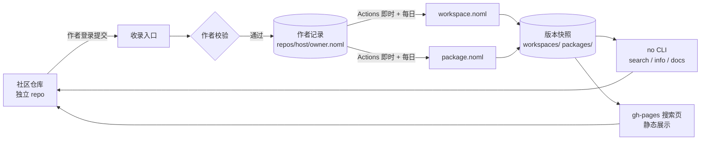

# nohub

> 一个「只索引、不存码」的社区包清单注册中心。

nohub 是一个面向社区第三方库的**元数据注册中心（metadata registry）**。它不托管任何源码，源码始终留在各自的独立仓库中；nohub 只负责收录、索引、准入审核与清单同步。

nohub 同时也是**一套 registry 规范 + 一个参考实现**：规范定义 noml 格式与同步/索引协议，参考实现部署在 `lizongying/nohub` 作为公共实例。任何人都可以自建结构一致的私有实例。

**nohub 自身只做同步**——它不提供 `search` / `info` / `docs` 命令。面向用户的检索、预览与文档入口已经集成到 Nolang 工具链 `no` 里：`no search <query>`、`no info <pkg>`、`no docs <pkg>` 直接从 nohub 仓库的 `packages/**/package.noml` 清单快照构建索引，`no` 客户端把多个实例作为源叠加检索。详见 [与 `no` CLI 的关系](#与-no-cli-的关系)。

完整的格式规范见 [`docs/noml-format.md`](docs/noml-format.md)，样例见 [`examples/`](examples/)。

---

## 核心定位

nohub 解决的是「社区包发现难、来源散、质量不可控」的问题，但刻意不做源码托管。它扮演的角色类似 crates.io 的索引、npm 的 registry 元数据层，而不是 GitHub。

具体来说，nohub 只做三件事：

1. **包清单索引与元数据 registry** —— 以 `noml` 清单为基本单元，为每个收录的包建立可检索的元数据记录。
2. **社区收录入口与版本解析** —— 用户提交一个 GitHub repo，nohub 自动同步该 repo 的 `workspace.noml` 与 `package.noml`，按 git tag 规则解析版本，并按仓库版本留存清单快照。
3. **准入审核** —— 所有收录都经过准入流程，保证索引里的每条记录都指向真实、可解析、符合规范的仓库。

nohub **不做**的事同样重要：不存放全部源码、不镜像仓库、不替代 CI、不干预包的实际发布流程；也不提供面向用户的搜索/预览/文档命令（这些在 `no` 里）。源码依然分散在各个独立 repo，nohub 只做索引、清单同步与准入审核。

---

## 架构总览



数据流很轻：用户提交一个 GitHub repo，准入通过后生成收录记录；同步任务（CRUD 后即时触发，外加每日兜底）按记录拉取该 repo 的 `workspace.noml` 与各个 `package.noml`，解析、校验后写入版本快照。检索侧不在 nohub：`no search/info/docs` 直接扫描 `packages/` 清单快照自建索引；gh-pages 静态搜索页则 fetch 工作流发布到分支根级的 noml 清单与快照，在浏览器里解析建索引（见 `docs/noml-format.md` 9.1）。两者都回跳原始仓库；`no add` / `no install` 直接指向仓库的 release。源码本身从不经过 nohub。

---

## 实例与多源

nohub 不是唯一的官方单点。规范约束的是**结构与协议**，不是部署位置。

- **公共实例**：参考实现部署在 `lizongying/nohub`，是默认的公共源。
- **自建实例**：任何人随时可以 clone 参考实现、指向自己的 `repos/` 部署私有实例，目录结构与公共实例完全一致。
- **实例隔离**：权限、审核、包可见性由每个实例自己管控；实例之间不互相同步作者记录或索引，也不共享用户与权限。A 实例的私有包不会出现在 B 实例。
- **多源客户端**：`no` 客户端维护一个源列表，每个源指向一个 nohub 实例；搜索时叠加所有源，结果带 `SOURCE` 列标明来源实例，同名同版本的包由**靠前的源优先**解析，也可以用 `-source <name>` 只看某个源。包引用沿用 `<pkg>@<host>/<owner>/<repo>`。

源列表落在客户端 `~/no/sources.noml`（noml 格式，数组顺序即优先级），每项就是一个 nohub 仓库地址 `<host>/<owner>/<repo>`（可写 `'名字 = 仓库地址'` 起别名，也可用本地 checkout 目录）：

```
{
  sources: [
    'github.com/lizongying/nohub',
    'corp = github.com/acme/nohub',
  ]
}
```

不配置时默认 `github.com/lizongying/nohub`；临时切换用 `NOHUB_SOURCES`（逗号分隔，覆盖配置文件）。某个源拉取失败只会告警，其余源照常返回结果。`no` 对每个源拉取仓库 tarball，扫描 `packages/**/package.noml` 与 `latest.noml` 自行建索引——与 `web/build.mjs` 用的是同一份数据，不读取生成的 `data.js`。

同一个 `repos/<host>/<owner>.noml` 可以同时存在于公共实例和某个私有实例，两者互不相干；作者在不同实例上是各自独立的收录记录。

---

## 三类 noml 文件

nohub 复用 Nolang 工具链（`no`）的 noml 格式，仓库里的 `workspace.noml` / `package.noml` 与 `no build` 读的是同一份文件。

| 文件 | 位置 | 谁写 / 谁读 | 作用 |
| --- | --- | --- | --- |
| `workspace.noml` | 仓库根目录 | 社区仓库 / `no`、nohub | 登记包名 → 仓库相对路径（纯字符串映射） |
| `package.noml` | 每个包目录 | 社区仓库 / `no`、nohub | 包元数据与编译选项 |
| `repos/<host>/<owner>.noml` | nohub `repos/` 下 | **仅作者本人** / nohub | 作者收录记录，驱动同步 |

`workspace.noml` 长这样（纯字符串映射，不能放对象值，否则 `no build` 会报错）：

```noml
{
  glossary: '/glossary'
  noui: '/noui'
  test1: '/example/test1'
}
```

`package.noml` 同时被 `no` 与 nohub 读取，nohub 的扩展字段（`category`、`docs`、`tag_pattern` 等）是 `no` 的未知键，会被 `no` 忽略：

```noml
{
  name: 'glossary'
  version: 'v0.1.0'
  description: 'Nolang 词条化知识库…'
  keywords: ['nolang', 'glossary', 'mcp', 'knowledge-base']
  repository: 'https://github.com/lizongying/nolang'
  license: 'Apache-2.0'

  ; ── nohub 扩展（no 忽略）──
  category: 'knowledge-base'
  docs: ''
  tag_pattern: 'v{version}'
  publish: true

  ; ── no 编译选项 ──
  compiler: {
    version: 'v0.4.19'
    link-libs: []
  }
  output: './dist'
}
```

作者记录按「一路径一作者」组织：`repos/github.com/lizongying.noml` 的路径即身份，内容是该作者名下仓库的 noml 数组。只有 GitHub 登录账号为 `lizongying` 的人，才能创建、修改、删除这份文件：

```noml
[
  'nolang',
  'notools',
  {
    name: 'nohub'
    branch: 'main'
    workspace: '/workspace.noml'
    sync: {
      schedule: 'daily'
      timezone: 'Asia/Shanghai'
    }
  },
]
```

元素 `<name>` 对应仓库 `https://<host>/<owner>/<name>`；字符串元素全部用缺省配置，对象元素可覆盖 `branch` / `workspace` / `sync`。字段细节、作者校验与兼容性约束见 [`docs/noml-format.md`](docs/noml-format.md)。

---

## 收录、作者授权与每日同步

开发者用 GitHub 账号登录后提交自己名下的仓库。nohub 先做作者校验：登录 login 必须等于路径里的 `<owner>`，且对每个仓库有 push 权限；通过后写入 `repos/<host>/<owner>.noml`，并**立即触发一次同步**，不必等每日任务。

同步有两个触发源：作者每次创建 / 修改 / 删除作者记录后即时触发，以及每日定时兜底。触发与执行都由 **GitHub Actions** 完成（`.github/workflows/sync.yml`），不需要常驻服务：工作流监听 `repos/**` 的 `push`，跑同步程序拉取上游清单、回写快照与 `latest.noml` 并提交。任务对每个 `active` 仓库：

1. 由 `<host>/<owner>/<name>` 推导仓库地址，用 `git ls-remote` 拿到全部 ref 与默认分支。
2. 列出**全部语义化 tag**，每个 tag 都是一个仓库版本（无 tag 时退化为分支 HEAD 短 SHA，只产生一个版本）。
3. 对每个版本拉取 `workspace.noml`；若不存在，回退到根目录的 `package.noml`（单包仓库）。
4. 遍历 `workspace.noml` 的键值，逐个拉取 `package.noml`。
5. **逐包**校验字段与版本标签；为每个版本写入快照，包级 `latest.noml` 与根 `latest.noml` 只指向最新版本，并把同步状态记入 `state/sync.noml`。

同步幂等：内容未变时不重写文件，只刷新同步时间。校验以包为单位做隔离——单个包不合法只跳过它自己，同仓库其他包照常入库，该仓库标记为 `partial`；一个包都没通过才整仓 `error`。仓库之间也互不影响，失败原因与告警都记入 `state/sync.noml`。

参考实现的同步逻辑在 `lib/sync.mjs`，命令行入口是 `bin/nohub.mjs`：

```bash
node bin/nohub.mjs sync                    # 全量同步
node bin/nohub.mjs sync github.com/o/r     # 只同步一个仓库（增量，不清理）
node bin/nohub.mjs sync --dry-run          # 只报告，不写盘
node bin/nohub.mjs sync --strict           # 有失败或部分成功时以非零码退出
node bin/nohub.mjs sync --root <dir>       # 指向另一个实例仓库
```

同步产出按**仓库版本**留存为不可变快照，路径与索引记录一一对应：

```
workspaces/<host>/<owner>/<repo>/<version>/workspace.noml
packages/<pkg>/<host>/<owner>/<repo>/<version>/package.noml
packages/<pkg>/<host>/<owner>/<repo>/latest.noml
latest.noml
state/sync.noml
```

`<version>` 是仓库的语义化 tag（如 `v0.4.28`、`v0.4.27`…），同步给每个 tag 各写一份快照；无 tag 时退化为分支 HEAD 短 SHA，只写一份。旧 tag 上若还没有 `workspace.noml` / `package.noml`，该版本只跳过并告警。`latest.noml` 分两层：根目录一份是全局版本指针，数组元素形如 `'glossary:v0.4.28@github.com/lizongying/nolang'`（只列最新版本）；`packages/<pkg>/<host>/<owner>/<repo>/latest.noml` 是包级指针 `{ version, commit }`，供索引构建读取。`state/sync.noml` 记录每个仓库的上次同步时间、状态、全部版本、跳过的包与告警。删除作者记录里的仓库时，对应快照与两层 `latest.noml` 一并清理。

**只有作者能创建、修改、删除自己的收录记录**：作者身份只看 GitHub 登录账号，不看 `package.noml` 里可随意填写的 `author` 字段。他人提交 PR 也会在合并前被同一套校验拦下。同步状态与包索引由 nohub 内部维护，不回写作者文件。

---

## 版本标签解析

版本与 git tag 的对应沿用既有的 git tag 依赖设计，由 `package.noml` 的 `version` 与可选的 `tag_prefix` / `tag_pattern` 决定：

1. 取 `version`；**该字段允许缺省**，缺省时用同步解析出的仓库版本兜底。
2. 有 `tag_pattern` 时把 `{version}` 替换为版本号；否则有 `tag_prefix` 时拼成 `tag_prefix + version`；否则 tag 直接等于 `version`。
3. 用 `git ls-remote` 确认 tag 存在并取得 commit SHA。
4. 把「版本 ↔ tag ↔ commit」写入索引。

tag 无法解析只告警、不拒绝写入：只有显式声明了 `tag_pattern` / `tag_prefix` 才要求命中的 tag 真实存在。仓库新增 tag 后，贡献者更新 `version` 并推送，同步会把新版本写进索引。

---

## 与 `no` CLI 的关系

nohub 只做清单同步，不提供面向用户的检索命令。搜索、预览与文档入口都在 Nolang 工具链 `no` 里，三个只读命令直接扫描 nohub 仓库的 `packages/**/package.noml` 清单快照构建索引，不涉及源码托管：

- **`no search <query>`** —— 按包名、关键词、分类检索，返回包名、描述、当前版本、仓库地址。
- **`no info <pkg>`** —— 展示包的元数据摘要（名称、版本、许可证、关键词、作者、commit），并给出安装/导入命令与文档地址。
- **`no docs <pkg>`** —— 打印文档 URL：优先取 `docs`，回退 `homepage`，再回退 `repository`；nohub 不缓存、不渲染文档内容。

`no` 默认读取公共仓库 `github.com/lizongying/nohub`。要叠加多个实例，在 `~/no/sources.noml` 配置仓库地址列表（见〈实例与多源〉）；`NOHUB_SOURCES` 可临时覆盖。三个命令都接受 `-source <name>` 只看指定源；`no search` 的输出带 `SOURCE` 列。gh-pages 上的静态搜索页是从同一份 `packages/` 清单构建的另一个视图。

三个命令的共同原则是「**指向而非托管**」：用户找到包后，再跳转到它真正的仓库与文档，或用 `no add` / `no install` 导入。

---

## 与源码仓库的关系

nohub 与源码仓库是**索引与被索引**的关系，边界清晰：

| 关注点 | nohub | 源码仓库 |
| --- | --- | --- |
| 源码 | 不存放 | 完整存放 |
| 版本历史 | 只记录 tag ↔ commit | 完整维护 |
| 清单快照 | 按仓库版本留存 | 随源码版本化 |
| 构建 / CI | 不参与 | 自行负责 |
| 包元数据 | 索引与检索（由 `no` 消费） | 以 `noml` 清单声明 |
| 文档内容 | 只提供入口 | 实际承载 |

这种设计让 nohub 保持轻量：它不需要存储大量源码，不需要处理构建产物，只维护一份可信的索引，并让社区包的发现与准入变得可控。

---

## 快速开始

提交一个社区仓库到 nohub：

```bash
# 1. 确认仓库根有 workspace.noml（多包）或 package.noml（单包）
#    多包仓库：workspace.noml 登记包名 -> 相对路径
#    每个包目录：package.noml 声明 name/version/repository/...

# 2. 通过收录入口提交 GitHub repo 地址
#    入口会生成 repos/<host>/<owner>.noml 并发起作者校验与准入审核

# 3. 审核通过后立即触发同步，拉取清单、写入版本快照与索引（每日任务兜底）
```

检索、预览、跳转到文档统一在 `no` 里完成（nohub 自身没有这些命令）：

```bash
no search glossary
no info glossary
no docs glossary
```

---

## 贡献指南

欢迎提交社区仓库，也欢迎改进 nohub 本身。提交前请确保：仓库公开可访问、`workspace.noml` 是纯字符串映射、每个包的 `package.noml` 字段完整且 `name` 与 workspace 键一致、写了 `version` 就要是语义化版本（不写则自动取仓库 tag）、许可证合规。清单需能被 `no fmt` 解析。

单个包不合法时 nohub 只跳过该包并告警，同仓库其他包照常收录，仓库标记为 `partial`；请在收到告警后尽快修正。审核反馈会附带具体原因，在仓库里修正后重新触发同步即可。若对格式、收录规则或同步策略有疑问，欢迎在 issue 中讨论。

---

## 许可证

nohub 项目本身的许可证见仓库根目录 `LICENSE` 文件。收录的社区包各自遵循其 `package.noml` 中声明的许可证。
