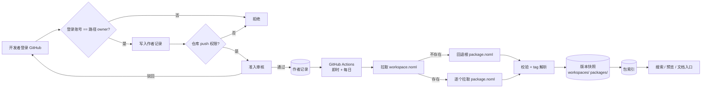

# nohub noml 格式规范

本文件定义 nohub 使用的 noml 格式。目标是：**用户提交一个 GitHub repo，nohub 自动同步该 repo 的 `workspace.noml` 与 `package.noml`，按仓库版本留存清单快照**。源码仍留在各自独立 repo，nohub 只保存清单快照；面向用户的搜索/预览/文档入口由 `no` CLI 直接扫描 `packages/**/package.noml` 快照构建索引提供，nohub 自身只做同步。

noml 不是新造格式，它复用 Nolang 工具链（`no`）的配置格式：`package.noml` / `workspace.noml` 本身就被 `no build` / `no run` 消费。nohub 与 `no` 读同一份文件，因此社区仓库不需要为 nohub 维护额外清单。

---

## 定位：规范 + 参考实现，多实例

nohub 不是唯一的官方单点，而是**一套 registry 规范 + 一个参考实现**。本文件定义规范：三类 noml 文件、同步与索引流程，以及索引如何被客户端消费。任何实现只要遵守这套规范，就能对外提供 nohub 兼容的 registry。

- **公共实例**：参考实现部署在 `lizongying/nohub`，是默认的公共源。
- **自建实例**：任何人随时可以 clone 参考实现、指向自己的 `repos/` 部署私有实例，目录结构与公共实例完全一致。
- **实例隔离**：权限、审核、包可见性由每个实例自己管控；实例之间不互相同步作者记录或索引，也不共享用户与权限。A 实例的私有包不会出现在 B 实例。
- **多源客户端**：`no` 客户端维护一个源列表，每个源指向一个 nohub 实例；搜索与安装时叠加所有源。包引用沿用 `<pkg>@<host>/<owner>/<repo>`，结果带来源实例，客户端按源优先级或显式指定解析。

规范约束的是**结构与协议**，不是部署位置：同一个 `repos/<host>/<owner>.noml` 既存在于公共实例，也可以存在于某个私有实例，两者互不相干。

---

## 1. 三类文件与职责

| 文件 | 位置 | 谁写 | 谁读 | 作用 |
| --- | --- | --- | --- | --- |
| `workspace.noml` | 仓库根目录 | 社区仓库 | `no`、nohub | 登记仓库内有哪些包、各在哪个路径 |
| `package.noml` | 每个包目录 | 社区仓库 | `no`、nohub | 单个包的元数据与编译选项 |
| `repos/<host>/<owner>.noml` | nohub 仓库 `repos/` 下 | 作者本人（GitHub 登录校验） | nohub 同步任务 | 记录该作者名下「同步哪些 repo、哪个分支、什么节奏」 |

`workspace.noml` 与 `package.noml` 是**社区仓库自持**的，随源码一起版本化；`repos/<host>/<owner>.noml` 是 **nohub 侧**的作者收录记录，存放在该 nohub 实例自己的仓库里（不放在社区仓库），且只有作者本人能创建、修改、删除。每个实例只维护自己的 `repos/`，不同实例的同名文件互不相干。

nohub 的同步只读前两者，作者记录负责驱动同步。同步产出分两类：写进包索引的元数据，以及按仓库版本留存的清单快照（见 6.8）。

---

## 2. noml 语法（复用 `no`）

noml 是 Nolang 字面量语法，不是 JSON、也不是 TOML。规则如下：

- 顶层是对象，`{` 与 `}` 各独占一行，成员一行一个，**换行即分隔，不用逗号**。
- 键：默认裸标识符，规则同 Nolang 变量名——下划线或小写字母开头，后续可含小写字母、数字、中划线、下划线；不能以数字开头。不符合规则的键写成单引号字符串键。
- 值：单引号字符串（`\` 转义 `\' \\ \n \t \r`）、`true` / `false`、`nil`、裸数字（整数/小数/指数）、对象 `{…}`、数组 `[…]`。
- 空值是 `nil` 而**不是** `null`：noml 本质是 Nolang 字面量，Nolang 没有 `null`，写 `null` 会被拒绝。
- 数组：元素用逗号分隔，支持尾随逗号；`[`、元素、`,`、`]` 都可跨行。
- 注释：`;` 到行尾（字符串内的 `;` 除外）；多行注释放在一对独立成行的 `;;` 之间。
- 成员注解：`#{key = value, …}`，只能独立成行写在成员上方，或写在成员同一行的尾随位置。
- 解析产出：`map[string]any` / `[]any` / `string` / `float64` / `bool` / `nil`。

一份最小对象长这样：

```noml
{
  name: 'demo'
  version: 'v0.1.0'
  tags: ['a', 'b',]
  compiler: {
    version: 'v0.4.19'
  }
}
```

示例文件见 `examples/workspace.noml`、`examples/package.noml`、`examples/repos/github.com/lizongying.noml`、`examples/latest.noml`，均通过 `no fmt` 校验。

---

## 3. workspace.noml

工作区清单，位于仓库根目录。它是**包短名 → 仓库相对路径**的纯字符串映射，值指向含 `package.noml` 的目录。

```noml
{
  glossary: '/glossary'
  noui: '/noui'
  test1: '/example/test1'
}
```

字段约定：

| 项 | 约定 |
| --- | --- |
| 键 | 包短名，必须与目标目录内 `package.noml` 的 `name` 一致 |
| 值 | 仓库相对路径，以 `/` 开头，指向含 `package.noml` 的目录 |
| 值类型 | 必须是字符串 |

**为什么不能有元数据键**：`no build` 通过 `LoadWorkspaceFile` 读取本文件，要求每个值都是字符串，遇到对象值会直接报错。因此工作区级元数据（仓库名、描述、主页等）不放在这里，而是由作者记录 `repos/<host>/<owner>.noml` 承载；包级元数据由各自的 `package.noml` 承载。

一个仓库如果只有一个包，也可以不写 `workspace.noml`，直接在根目录放 `package.noml`；nohub 对这种「单包仓库」有回退处理（见第 6 节）。

---

## 4. package.noml

包清单，位于每个包目录。它同时被 `no` 与 nohub 读取：`no` 用它的编译相关字段，nohub 用它的元数据字段。nohub 的扩展字段以「未知键」形式存在——`no` 的 `DecodeInto` 会跳过未知键，因此扩展对 `no` 完全透明。

```noml
{
  name: 'glossary'
  version: 'v0.1.0'
  description: 'Nolang 词条化知识库…'
  keywords: ['nolang', 'glossary', 'mcp', 'knowledge-base']
  author: 'lizongying'
  email: 'lizongying@msn.com'
  organization: ''
  repository: 'https://github.com/lizongying/nolang'
  homepage: ''
  license: 'Apache-2.0'
  dependencies: []
  dev-dependencies: []

  ; ── nohub 扩展（no 忽略）──
  category: 'knowledge-base'
  docs: ''
  readme: '/README.md'
  tag_pattern: 'v{version}'
  publish: true

  ; ── no 编译选项 ──
  compiler: {
    version: 'v0.4.19'
    link-libs: []
    anonymous-fn-type: false
  }
  output: './dist'
  ignore: ['dist']
}
```

### 4.1 通用字段（与 `no` 一致）

| 字段 | 类型 | 说明 |
| --- | --- | --- |
| `name` | str | 包名，实例内唯一标识 |
| `version` | str | 缺省取仓库版本 | 当前收录版本；**可缺省**，缺省时回落到同步解析出的仓库版本（见第 7 节） |
| `description` | str | 一句话描述，用于搜索与预览 |
| `keywords` | []str | 关键词，用于搜索 |
| `author` / `email` / `organization` | str | 作者信息 |
| `repository` | str | 源码仓库地址 |
| `homepage` | str | 主页 |
| `license` | str | SPDX 许可证标识 |
| `main` | str | 入口文件（`no` 用） |
| `dependencies` / `dev-dependencies` | []str | 依赖，元素形如 `'key:version'`、`'key'`、`'/local/path'`、`'key@github.com/owner/repo'` |
| `ignore` | []str | 忽略模式 |
| `alias` / `mirrors` | map / []str | 别名与下载镜像 |
| `compiler` | obj | 编译选项：`version`、`link-libs`、`anonymous-fn-type` |
| `output` | str | 输出目录 |

### 4.2 nohub 扩展字段（`no` 忽略）

| 字段 | 类型 | 缺省 | 说明 |
| --- | --- | --- | --- |
| `category` | str | 由 workspace 路径推断 | 分类，用于搜索筛选与频道归类 |
| `docs` | str | `homepage` → `repository` | 文档入口 URL；留空则按回退链取值 |
| `readme` | str | `/README.md` | 仓库相对路径，预览时展示 |
| `tag_prefix` | str | `''` | tag 前缀，详见第 7 节 |
| `tag_pattern` | str | 用 `version` 作 tag | tag 模板，`{version}` 占位 |
| `publish` | bool | `true` | 是否对外可见；`false` 仅入库不展示 |

依赖元素沿用 `no` 的 `SplitDepSpec` 规则：以最后一段路径之后的最右侧 `:` 切分 key 与 version；version 可省略（默认 `*`）；支持 `nogit:v0.1.33@github.com/o/r` 内嵌版本形式。

---

## 5. repos/<host>/<owner>.noml（作者收录记录）

每个作者（GitHub 用户或组织）对应一份文件，**路径即身份**：`repos/github.com/lizongying.noml`。文件内容是该作者名下仓库的 **noml 数组**，元素是仓库短名。同步任务按它驱动。它不放在社区仓库里。

```noml
[
  'nolang',
  'notools',
]
```

元素 `<name>` 对应仓库 `https://<host>/<owner>/<name>`。全部用缺省配置时，数组就是一份仓库名单，例如上面这份表示同步 `github.com/lizongying/nolang` 与 `github.com/lizongying/notools`。

缺省配置：

| 项 | 缺省 |
| --- | --- |
| `branch` | 仓库默认分支 |
| `workspace` | `/workspace.noml` |
| `sync` | `daily`（时区 `Asia/Shanghai`） |
| `status` | `active` |

需要给单个仓库覆盖配置时，把该元素写成对象，未写的字段仍取缺省：

```noml
[
  'nolang',
  {
    name: 'notools'
    branch: 'dev'
    workspace: '/noml/workspace.noml'
    sync: {
      schedule: 'daily'
      timezone: 'Asia/Shanghai'
    }
  },
]
```

对象字段：

| 字段 | 类型 | 必填 | 说明 |
| --- | --- | --- | --- |
| `name` | str | 是 | 仓库短名，与路径 `<owner>/<name>` 一致 |
| `branch` | str | 否 | 同步分支或 tag，缺省取仓库默认分支 |
| `workspace` | str | 否 | 工作区清单的仓库相对路径，缺省 `/workspace.noml` |
| `status` | str | 否 | `active` / `paused`，缺省 `active` |
| `sync` | obj | 否 | `schedule` 与 `timezone`，缺省 `daily` / `Asia/Shanghai` |

作者文件只声明「同步哪些仓库、怎么同步」，是**作者可写**的；同步状态（`last_sync_at`、`last_sync_status`、`last_sync_error`）与包索引由 nohub 内部维护，不回写作者文件，作者也无权修改。只有作者本人能创建、修改、删除这份文件，规则见第 6 节。

---

## 6. 提交、作者授权与每日同步



### 6.1 作者身份校验

nohub 通过 GitHub 登录确定开发者身份，路径 `repos/<host>/<owner>.noml` 中的 `<owner>` 就是作者标识。校验链如下：

1. 开发者用 GitHub 账号登录 nohub（GitHub App 或 OAuth），nohub 取得 GitHub login。
2. 目标路径的 `<owner>` 与登录 login 完全相等，否则拒绝写入。大小写不敏感，但归一化后必须一致。
3. 对数组里每个仓库，调 GitHub API 确认它存在且登录账号有 push 权限（`permissions.push` 为 true，或账号是该 org 的 owner），防止作者把他人仓库挂到自己名下。
4. 可选加强：校验仓库 `package.noml` 的 `author` 或 `repository` 字段与登录账号一致。

`<owner>` 既可以是 GitHub 用户，也可以是组织。组织场景下，登录账号需是组织成员且对目标仓库有 push 权限。

### 6.2 CRUD 规则

| 操作 | 规则 |
| --- | --- |
| 创建 | 登录 login == `<owner>`，且该文件尚不存在 |
| 修改 | 登录 login == `<owner>` |
| 删除 | 登录 login == `<owner>` |
| 读取 | 公开，无需登录 |

只有作者本人能创建、修改、删除自己的收录记录。他人即使提交 PR，也会在合并前被同一套校验拦下。作者的判断只看 GitHub 身份，不看邮箱或 `package.noml` 里的 `author` 字段——后者可被随意填写，不能作为授权依据。

每次创建、修改、删除成功后，nohub 会**立即触发一次同步**（见 6.4），不必等每日任务。

### 6.3 实现方式

两种可选，可叠加：

- **GitHub App**：nohub 作为 GitHub App 安装到作者仓库，用 installation token 调 GitHub API 校验权限并直接写文件。权限模型清晰，推荐。
- **OAuth + PR**：作者登录后，nohub 把改动开成 PR，由作者本人 review 并 merge；合并时再校验一次身份。实现简单，但首次接入需要作者安装 App 或授权。

无论哪种方式，每次变更都要记录审计信息：actor（GitHub login）、时间、变更 diff。仓库转移或账号改名时，需作者重新认证并迁移记录路径。

### 6.4 同步触发与执行（GitHub Actions）

同步由 nohub 仓库里的 **GitHub Actions 工作流**执行，不需要常驻服务：作者记录本身就落在 GitHub 仓库里，工作流感知到改动后自动跑同步并回写快照。

三个触发源：

- **即时同步**：工作流监听 `push` 且 `paths: repos/**`。作者每次创建 / 修改 / 删除作者记录后自动触发，对受影响的仓库执行一次增量同步。创建、修改触发拉取与写入，删除触发清理（见 6.8）。
- **每日同步**：工作流的 `schedule` cron（缺省每日一次，时区 `Asia/Shanghai`）兜底，用于发现上游新增 tag、修复失败。
- **手动 / API**：`workflow_dispatch` 触发，可只同步指定仓库。

参考工作流 `.github/workflows/sync.yml`：

```yaml
name: sync
on:
  schedule:
    - cron: '0 0 * * *'          # 每日 00:00 UTC = Asia/Shanghai 08:00
  workflow_dispatch:
    inputs:
      repo:
        description: '只同步 host/owner/repo，留空则全量'
        required: false
  push:
    branches: [main]
    paths: ['repos/**']

permissions:
  contents: write

jobs:
  sync:
    runs-on: ubuntu-latest
    steps:
      - uses: actions/checkout@v7
      - uses: actions/setup-node@v7
        with:
          node-version: 24
          package-manager-cache: false
      - name: 同步清单
        run: node bin/nohub.mjs sync ${{ inputs.repo }} --strict
      - name: 重建索引
        run: node web/build.mjs
      - name: 回写快照
        run: |
          git add workspaces packages latest.noml state web/data.js web/index.noml web/noml.js
          git diff --cached --quiet && exit 0
          git -c user.name='nohub-bot' \
              -c user.email='nohub-bot@users.noreply.github.com' \
              commit -m 'sync: update manifests'
          git push

      # 搜索页部署在 gh-pages：页面文件 + 根级 noml 数据（packages/ workspaces/ latest.noml）。
      - name: 同步搜索页（gh-pages）
        continue-on-error: true
        run: |
          set -e
          SRC=$(git rev-parse HEAD)
          git fetch --depth 1 origin +refs/heads/gh-pages:refs/remotes/origin/gh-pages
          git checkout -B gh-pages origin/gh-pages
          git rm -rf -q . || true
          for f in index.html app.js styles.css noml.js; do git show "$SRC:web/$f" > "$f"; done
          git show "$SRC:latest.noml" > latest.noml
          git show "$SRC:web/index.noml" > index.noml
          git archive "$SRC" packages workspaces | tar -x
          git add -A
          git diff --cached --quiet && exit 0
          git -c user.name='nohub-bot' \
              -c user.email='nohub-bot@users.noreply.github.com' \
              commit -m 'pages: sync web + noml data'
          git push origin gh-pages
```

工作流回写 `workspaces/`、`packages/`、`latest.noml`、`state/`、`web/data.js`、`web/index.noml`、`web/noml.js`，不碰 `repos/`，因此不会自我触发。`schedule` 在仓库长期无活动时可能被 GitHub 停用，所以即时同步（`push`）是主要触发来源。注意 `push` 触发条件限定 `repos/**`，改动 `web/`、`.github/` 后需要在 Actions 页面手动 `Run workflow` 才会部署 gh-pages。

### 6.5 命令行

参考实现的同步逻辑落在 `lib/sync.mjs`，命令行入口是 `bin/nohub.mjs`，工作流调用的就是它：

```bash
node bin/nohub.mjs sync                        # 全量同步（会清理已移除仓库的快照）
node bin/nohub.mjs sync github.com/o/r         # 只同步一个仓库（增量，不清理）
node bin/nohub.mjs sync owner/repo             # 简写，缺省 github.com
node bin/nohub.mjs sync --dry-run              # 只报告，不写盘
node bin/nohub.mjs sync --strict               # 有失败或部分成功时以非零码退出
node bin/nohub.mjs sync --root <dir>           # 指向另一个实例仓库
```

`--root` 让同一份代码可以驱动任意 nohub 实例（公共实例或私有实例），目录结构要求一致。

### 6.6 同步步骤与状态

任务对作者文件里每个 `status` 为 `active` 的仓库执行：

1. 由 `<host>/<owner>/<name>` 推导出仓库地址，用 `git ls-remote --symref` 一次拿到全部 ref 与默认分支。
2. 按第 7 节解析出**仓库版本**（最新语义化 tag，无 tag 时退化为分支 HEAD 短 SHA），作为快照目录名与抓取用的 ref。
3. 拉取 `workspace`（缺省 `/workspace.noml`）指向的 `workspace.noml`。
4. 若该文件不存在，回退到仓库根目录的 `package.noml`，把仓库当作单包处理。
5. 若有 `workspace.noml`，遍历其键值，逐个拉取 `<repo>/<path>/package.noml`。
6. 对**每一份**清单单独做字段校验（第 8 节）。单个包不合法只跳过它自己，不连坐整个仓库。
7. 校验通过的包写入版本快照（见 6.8）与包级 `latest.noml`，并汇总进根 `latest.noml`。
8. 把每个仓库的同步状态写入 `state/sync.noml`。

同步是幂等的：清单内容未变化时不重写文件，只刷新同步时间。单个仓库失败不影响其他仓库；单个包失败把该仓库标记为 `partial`，失败原因记进 `state/sync.noml` 与告警。

`state/sync.noml` 是 nohub 内部状态，**不是**规范要求的三类文件之一，参考实现用它记录上次同步结果，便于排查与增量判断：

```noml
{
  'github.com/lizongying/nolang': {
    last_sync_at: '2026-11-20T08:00:00.000Z'
    last_sync_status: 'ok'
    last_sync_error: nil
    repo_version: 'v0.4.28'
    commit: '49ab71ed60ae719418f2351986be71748fa843fe'
    branch: 'main'
    packages: ['test1', 'test2', 'test', 'glossary']
    skipped: []
    warnings: [
      'test1: 缺少 license',
    ]
  }
}
```

`last_sync_status` 取值 `ok` / `partial` / `error` / `skipped`；`skipped` 列出被跳过的包及原因。

### 6.7 仓库地址解析

仓库地址由路径推导：`https://<host>/<owner>/<name>`。同步时按 GitHub 的 raw 地址规则拼出文件地址；`branch` 决定取哪个 ref 的文件。非 GitHub 托管的平台只要提供等价的 raw 文件访问即可，否则准入阶段驳回。

### 6.8 版本快照存储

同步不是只写索引，而是把清单按**仓库版本**留存为可寻址的快照。快照存放在 nohub 实例自己的仓库里，源码仍不落地。

```
workspaces/<host>/<owner>/<repo>/<version>/workspace.noml
packages/<pkg>/<host>/<owner>/<repo>/<version>/package.noml
packages/<pkg>/<host>/<owner>/<repo>/latest.noml
latest.noml
```

- `<host>/<owner>/<repo>` 由作者记录路径解析。
- `<pkg>` 是 `workspace.noml` 的键，必须与 `package.noml` 的 `name` 一致。
- `<version>` 是**仓库版本**：同步时用 `git ls-remote --tags` 取该仓库最新的语义化 tag（如 `v0.4.28`）；仓库没有 tag 时退化为 `branch` HEAD 的短 SHA。它决定快照目录的名字，与 `package.noml` 里包自报的 `version` 字段可以不同。
- `latest.noml` 分两层：
  - **全局**：仓库根目录一份，noml 数组，每个元素是一条 `<pkg>:<version>@<host>/<owner>/<repo>` 规格（与 `no` 的依赖写法 `key:version@host/owner/repo` 一致），供搜索与安装快速列出所有包的最新版本。
  - **包级**：`packages/<pkg>/<host>/<owner>/<repo>/latest.noml`，对象 `{ version, commit }`，记录该包当前最新的仓库版本与 commit，供索引构建读取 `latestCommit`。

```noml
[
  'glossary:v0.4.28@github.com/lizongying/nolang',
  'nogit:v0.1.35@github.com/lizongying/notools',
  'noimg:v0.1.35@github.com/lizongying/notools',
]
```

一次同步对某个仓库产出：

```
workspaces/github.com/lizongying/nolang/v0.4.28/workspace.noml
packages/glossary/github.com/lizongying/nolang/v0.4.28/package.noml
packages/noui/github.com/lizongying/nolang/v0.4.28/package.noml
packages/glossary/github.com/lizongying/nolang/latest.noml
```

并在根目录 `latest.noml` 写入/更新对应条目，例如 `'glossary:v0.4.28@github.com/lizongying/nolang'`。

快照是**不可变**的：同一 `<version>` 目录一旦写入就不再修改；版本更新写新目录，旧版本保留，`latest.noml` 原子指向新版本。删除作者记录里的仓库时，同步任务清理该仓库的 `workspaces/...` 与 `packages/...` 目录（含包级 `latest.noml`），并从根 `latest.noml` 移除对应条目、从索引移除；已安装用户不受影响，因为源码始终在原仓库。

---

## 7. 版本标签解析

版本与 git tag 的对应沿用既有的 git tag 依赖设计，由 `package.noml` 的 `version` 与可选的 `tag_prefix` / `tag_pattern` 决定。

解析流程：

1. 取 `package.noml` 的 `version`。**该字段可以缺省**：缺省时用同步解析出的仓库版本（最新语义化 tag，无 tag 时为分支 HEAD 短 SHA）兜底。真实上游仓库里，一个工作区下多个包往往只在 `compiler.version` 里写工具版本，而不各自声明包版本，因此缺省是常态而非例外。
2. 若存在 `tag_pattern`，把 `{version}` 替换为上一步得到的版本得到 tag；否则若存在 `tag_prefix`，tag 为 `tag_prefix + version`；否则 tag 直接等于该版本。
3. 通过 `git ls-remote` 确认该 tag 在仓库中存在，并取得其 commit SHA。
4. 把「版本 ↔ tag ↔ commit」写入索引。

**tag 不可解析只告警，不拒绝写入**：只有包显式声明了 `tag_pattern` 或 `tag_prefix` 时，才要求它命中的 tag 真实存在；未声明时 tag 缺省等于包自报的 `version`，与仓库 tag 本就可以不同，缺失只是信息，不是错误。

仓库新增 tag 后，贡献者更新 `package.noml` 的 `version`（必要时调整 `tag_pattern`）并推送，同步会把新版本写进索引。nohub 不主动轮询 tag，版本更新由同步触发。

注意区分两个「版本」：这里的包版本是 `package.noml` 里声明的版本（缺省则为仓库版本），用于索引的 `version` 字段；快照目录的 `<version>` 是**仓库版本**（同步时取最新 tag），与包版本可以不同，见 6.8。

---

## 8. 准入审核

校验分两层：**写入校验**在收录入口执行，决定作者能否创建/修改/删除记录；**同步校验**在每次同步执行，决定能否写入索引。

写入校验（对应第 6.1、6.2 节）：

| 校验项 | 规则 |
| --- | --- |
| 作者身份 | 登录 GitHub login == 路径 `<owner>` |
| 仓库存在 | 数组里每个 `<name>` 对应 `https://<host>/<owner>/<name>` 存在且公开 |
| 仓库权限 | 登录账号对每个仓库有 push 权限（用户或组织） |
| 文件归属 | 创建时文件不存在；修改/删除时登录账号仍是 `<owner>` |

同步校验（每次拉取清单后，**逐包**执行）：

| 校验项 | 规则 | 不满足时 |
| --- | --- | --- |
| 仓库可访问 | `repository` 公开可读，raw 文件可取 | 整仓失败 |
| 工作区存在 | `workspace.noml` 存在，或根目录存在 `package.noml` | 整仓失败 |
| 清单可解析 | 每份 `package.noml` 是合法 noml 且顶层为对象 | 跳过该包 |
| 名称一致 | `workspace.noml` 的键与对应 `package.noml` 的 `name` 一致 | 跳过该包 |
| 版本合法 | `version` 若写了则必须是语义化版本；**允许缺省**，缺省回落到仓库版本 | 跳过该包 |
| tag 可解析 | 仅当显式声明 `tag_pattern` / `tag_prefix` 时要求命中的 tag 存在 | 告警 |
| 许可证合规 | `license` 若写了则必须是有效 SPDX 标识字符串 | 跳过该包 |
| 许可证存在 | `license` 允许缺省 | 告警 |
| 无重复收录 | 包名在本实例内唯一（跨实例允许同名，由源区分） | 跳过该包 |
| 可见性 | `publish: false` 的包入库但不对外展示 | — |

**失败隔离**：校验以包为单位。单个包不合法只跳过它自己，同一仓库的其他包照常入库，该仓库标记为 `partial`；一个包都没通过时整仓标记 `error` 且不写任何快照。仓库之间也互相隔离，一个仓库失败不影响其他仓库。跳过原因与告警都记入 `state/sync.noml`。

整仓失败（网络、`workspace.noml` 结构非法、单包仓库缺少 `name` 等）时记录具体原因，作者修正仓库内的清单后可重新触发同步。若作者身份校验失败，整个写入请求直接拒绝，不进入同步。

---

## 9. 索引输出

nohub 同步产出的是 `packages/**/package.noml` 快照与 `latest.noml`；`no search` / `no info` / `no docs` 直接扫描这些清单、各自构建索引（字段映射与 `web/build.mjs` 一致），nohub 自身不提供 CLI 检索命令。gh-pages 静态搜索页不扫源仓库，而是 fetch 同步工作流发布到分支根级的 noml 数据（见 9.1）。每条记录包含：

| 字段 | 来源 |
| --- | --- |
| `name` | `package.noml` |
| `version` / `tag` / `commit` | 版本标签解析结果（`version` 缺省时为仓库版本，见第 7 节） |
| `repo_version` | 同步时解析的仓库版本，即快照目录名（见 6.8） |
| `docs_url` / `snapshot_path` / `latest_commit` | docs 回退链结果；快照相对路径；包级 `latest.noml` 的 commit |
| `description` / `keywords` / `category` | `package.noml` |
| `author` / `email` / `organization` | `package.noml` |
| `repository` / `homepage` / `docs` | `package.noml`（docs 按回退链） |
| `readme` | `package.noml` |
| `license` | `package.noml` |
| `workspace` / `path` | `workspace.noml` |
| `source` | 所属 nohub 实例的源标识 |
| `owner` / `host` | 由路径 `repos/<host>/<owner>.noml` 解析 |
| `repo` / `branch` | 作者文件数组元素 + 缺省值 |
| `publish` | `package.noml` |
| `synced_at` | 同步任务 |

索引只保存这些元数据，不保存源码。每条记录都对应一份不可变快照 `packages/<name>/<host>/<owner>/<repo>/<repo_version>/package.noml`。

### 9.1 gh-pages 数据布局与前端解析

`web/build.mjs` 除了 `web/data.js`（本地预览注入），还生成一份快照清单 `web/index.noml`：枚举全部 `packages/<name>/<host>/<owner>/<repo>/<repo_version>/package.noml` 与包级 `latest.noml`。工作流把它和同步产出的 `packages/`、`workspaces/`、`latest.noml` 一起发布到 gh-pages 根级：

```
index.html  app.js  styles.css  noml.js
index.noml                  # 快照清单：snapshots[] 逐条列出 snapshot / latest 相对路径
latest.noml                 # 根清单：['name:version@host/owner/repo', ...]
packages/<name>/<host>/<owner>/<repo>/
  latest.noml
  <repo_version>/package.noml
workspaces/<host>/<owner>/<repo>/<repo_version>/workspace.noml
```

页面加载流程：

1. `app.js` 先 `fetch('index.noml')` 取清单（本地预览由注入的 `data.js` 直接提供同结构索引，跳过 fetch）。
2. 再 `fetch('latest.noml')` 取根清单，得到每个仓库分组默认展示的版本（`latest.noml` 缺失时退回版本最高者）。
3. 按清单逐份 `fetch('<snapshot>')` 与 `fetch('<latest>')`，交给 `web/noml.js` 暴露的 `window.NOML.parse` 解析（与 `lib/noml.mjs` 同一份语法实现），映射成与上表一致的记录后渲染。

`data.js` 不发布到 gh-pages，因此线上页面始终走 fetch + noml 解析路径；`packages/`、`workspaces/`、`latest.noml` 原样发布，可直接被其它工具 fetch。

---

## 10. 兼容性约定

nohub 与 `no` 共用 `workspace.noml` / `package.noml`，因此有两条硬约束：

1. `workspace.noml` 只能是字符串映射，不能放对象值——否则 `no build` 会因 `LoadWorkspaceFile` 的类型检查失败而报错。
2. `package.noml` 的 nohub 扩展字段必须是 `no` 未知键——`no` 的 `DecodeInto` 会跳过未知键，既不报错也不影响编译。

只要遵守这两条，同一份清单既能被 `no build` / `no run` 使用，也能被 nohub 同步索引，社区仓库无需维护两套文件。
